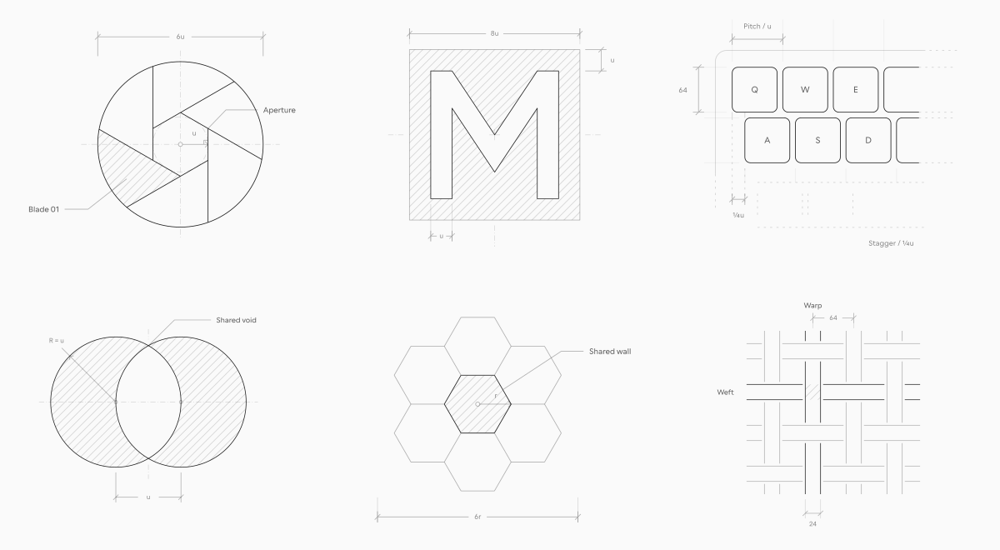
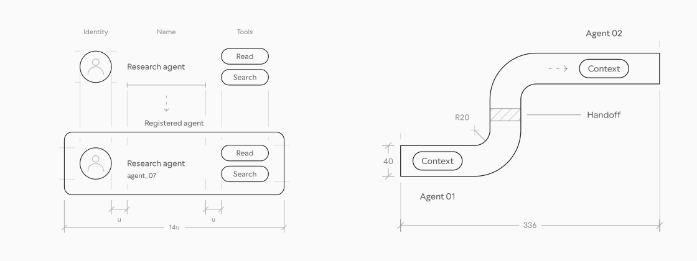
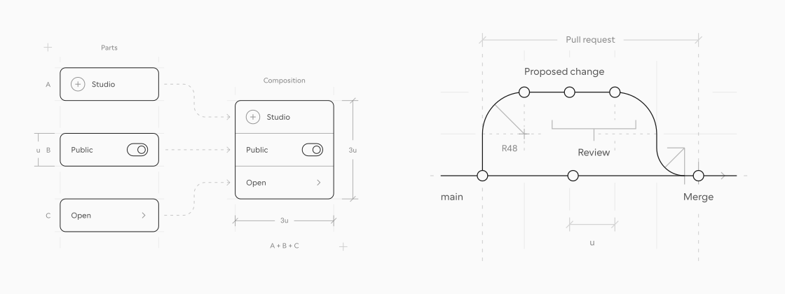
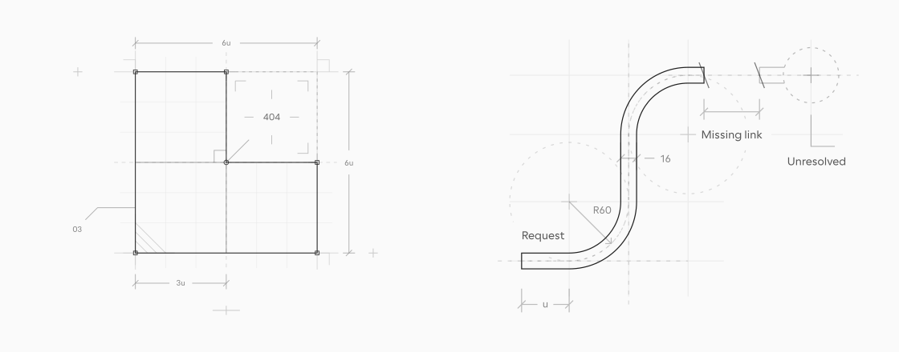
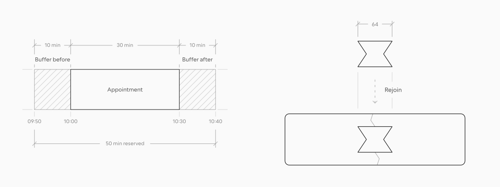
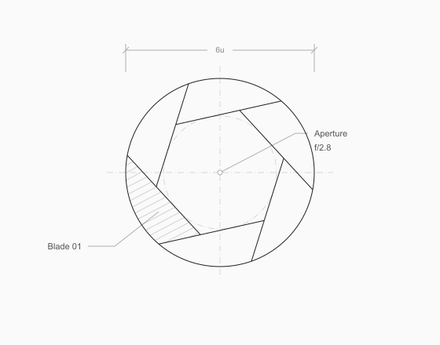

# Plotter

**Blueprint illustrations for product ideas.**

Give your coding agent a brief. Plotter helps it draw precise, editable illustrations for agent workflows, interfaces, empty states, and the concepts behind a feature.

[Explore the catalogue](https://plotter.pasqualevitiello.com/illustrations) · [Install the skill](#install-plotter) · [See it move](#make-it-move) · [Visual grammar](https://plotter.pasqualevitiello.com/grammar) · [Docs](https://plotter.pasqualevitiello.com/docs)

[](https://plotter.pasqualevitiello.com/illustrations)

Use the catalogue as a reference, then ask for a drawing that fits your product. Try the example briefs below with `$plotter` in Codex or `/plotter` in Claude Code.

## Explain agent workflows

Show what an agent knows, which tools it can use, and how context passes to the next agent. Useful for onboarding, agent directories, and workflow documentation.

[](https://plotter.pasqualevitiello.com/illustrations)

[An agent, registered](skills/plotter/references/catalogue/AGT-01.svg) · [Context, carried forward](skills/plotter/references/catalogue/AGT-03.svg)

<details>
<summary>Try an agent illustration</summary>

```text
$plotter Draw an agent registration flow: identity, name, and two tools
become one registry record. Keep each part aligned as it joins.
Deliver an editable SVG for an onboarding page.
```

</details>

## Explain interfaces and workflows

Reveal how components form a product, or how a change moves through a system. Use these in feature pages, design-system documentation, and technical explainers.

[](https://plotter.pasqualevitiello.com/illustrations)

[Recombination](skills/plotter/references/catalogue/INT-04.svg) · [A change, brought together](skills/plotter/references/catalogue/SRV-06.svg)

<details>
<summary>Try a product explainer</summary>

```text
$plotter Draw three interface fragments—identity, visibility, and action—
assembling into one compact panel. Show their shared spacing
and corner rule. Deliver an editable SVG for a feature page.
```

</details>

## Give empty states something to say

Make a missing destination or an unanswered search understandable through the drawing itself. Useful for 404 pages, search results, and first-use screens.

[](https://plotter.pasqualevitiello.com/illustrations)

[The missing destination](skills/plotter/references/catalogue/EMP-05.svg) · [A search, unanswered](skills/plotter/references/catalogue/EMP-06.svg)

<details>
<summary>Try an empty state</summary>

```text
$plotter Draw a 404 illustration: a route reaches a closed end just
before an unbuilt destination. Let the missing connection
carry the idea. Deliver an editable SVG with a transparent background.
```

</details>

## Make an abstract feature tangible

Turn time buffers into measured intervals, or repair into a joint that reconnects two parts. Use a clear construction relationship for feature announcements, help articles, and product pages.

[](https://plotter.pasqualevitiello.com/illustrations)

[Appointment buffers](skills/plotter/references/catalogue/TIM-06.svg) · [Rejoin](skills/plotter/references/catalogue/CRF-06.svg)

<details>
<summary>Try a visual metaphor</summary>

```text
$plotter Draw a 30-minute appointment between two 10-minute buffers.
Make the proportions visible and label the 50-minute total.
Deliver an editable SVG for a scheduling feature announcement.
```

</details>

## Make it move

Use motion to show what changes and what stays fixed. In this iris study, six blades change the opening while the center, outer ring, and aperture readout remain easy to follow.

<a href="https://plotter.pasqualevitiello.com/animations#iris-aperture-animation">
  <picture>
    <source media="(prefers-reduced-motion: reduce)" srcset=".github/assets/iris-aperture.svg">
    
  </picture>
</a>

[Browse the motion studies](https://plotter.pasqualevitiello.com/animations) · [Read the animation workflow](https://plotter.pasqualevitiello.com/docs/animation)

<details>
<summary>Animate an existing drawing</summary>

Attach its editable SVG and describe the movement:

```text
$plotter Animate this iris through three aperture settings.
Keep the center fixed and the hatching attached to its blade.
Update the f-number with the opening, pause at each setting,
and reopen slowly. Deliver standalone HTML with a static fallback.
```

For Claude Code, replace `$plotter` with `/plotter`.

</details>

Get editable SVG for stills, or standalone HTML with a static fallback for motion. Both workflows share the same [visual grammar](https://plotter.pasqualevitiello.com/grammar): transparent forms, a clear line hierarchy, and supporting marks that explain the construction.

## Install Plotter

[Download the complete skill](https://plotter.pasqualevitiello.com/plotter/downloads/plotter.zip), extract it, and place the `plotter` folder in your agent’s skills directory:

| Agent       | Install at                 | Invoke with |
| ----------- | -------------------------- | ----------- |
| Codex       | `~/.codex/skills/plotter`  | `$plotter`  |
| Claude Code | `~/.claude/skills/plotter` | `/plotter`  |

Keep `SKILL.md`, `agents/`, `assets/`, `references/`, and `scripts/` together. Start a new agent session after installation. The skill works independently of the website; from a checkout, you can copy [`skills/plotter`](skills/plotter) directly.

[Installation guide](https://plotter.pasqualevitiello.com/docs/installation) · [Drawing workflow](https://plotter.pasqualevitiello.com/docs/drawing) · [Token customization](https://plotter.pasqualevitiello.com/docs/customization)

<a id="run-the-website"></a>

<details>
<summary>Run the website locally</summary>

With [Bun](https://bun.sh) installed:

```sh
bun install
bun run dev
```

Open [localhost:3000](http://localhost:3000). See [Contributing](CONTRIBUTING.md) for source boundaries, generation, and formatting.

</details>

Made by [Pasquale Vitiello · @pacovitiello](https://x.com/pacovitiello). Built with [coss ui](https://coss.com/ui).

[plotter.pasqualevitiello.com](https://plotter.pasqualevitiello.com) · [MIT license](LICENSE) · [Source credits](ATTRIBUTION.md)
