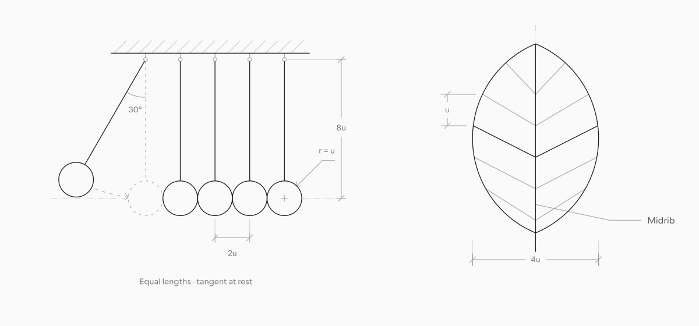

# Plotter

A skill for drawing and animating editable blueprint illustrations with your coding agent.

[plotter.pasqualevitiello.com](https://plotter.pasqualevitiello.com) · [Illustrations](https://plotter.pasqualevitiello.com/illustrations) · [Animations](https://plotter.pasqualevitiello.com/animations) · [Visual grammar](https://plotter.pasqualevitiello.com/grammar) · [Docs](https://plotter.pasqualevitiello.com/docs)

[](https://plotter.pasqualevitiello.com/illustrations)

## Use the skill

[Download Plotter](https://plotter.pasqualevitiello.com/plotter/downloads/plotter.zip), extract it, and place the complete `plotter` folder in your agent’s skills directory:

| Agent       | Install at                 | Invoke with |
| ----------- | -------------------------- | ----------- |
| Codex       | `~/.codex/skills/plotter`  | `$plotter`  |
| Claude Code | `~/.claude/skills/plotter` | `/plotter`  |

Keep `SKILL.md`, `agents/`, `assets/`, `references/`, and `scripts/` together, then start a new agent session. The skill works without this website or repository. From a checkout, you can copy [`skills/plotter`](skills/plotter) directly. See the [installation guide](https://plotter.pasqualevitiello.com/docs/installation) for updates and requirements.

**Draw**

```text
$plotter Draw a camera iris with six overlapping blades.
Deliver an editable 560 × 440 SVG. Keep the forms transparent
and use hatching to identify one visible blade.
```

**Animate** — attach the editable drawing.

```text
$plotter Animate this iris through three aperture settings.
Keep the center fixed and the hatching attached to its blade.
Deliver standalone HTML with a reduced-motion static fallback.
```

For Claude Code, replace `$plotter` with `/plotter`.

<a href="https://plotter.pasqualevitiello.com/animations#iris-aperture-animation">
  <picture>
    <source media="(prefers-reduced-motion: reduce)" srcset=".github/assets/iris-aperture.svg">
    
  </picture>
</a>

## Run the website

With [Bun](https://bun.sh) installed:

```sh
bun install
bun run dev
```

Open [localhost:3000](http://localhost:3000). See [Contributing](CONTRIBUTING.md) for source boundaries, generation, and formatting.

Made by [Pasquale Vitiello · @pacovitiello](https://x.com/pacovitiello). Built with [coss ui](https://coss.com/ui).

Licensed under [MIT](LICENSE). See [ATTRIBUTION.md](ATTRIBUTION.md) for source credits and third-party notices.
