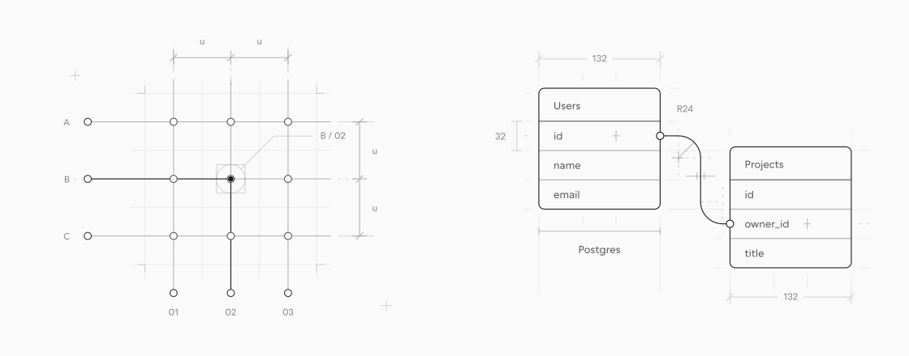
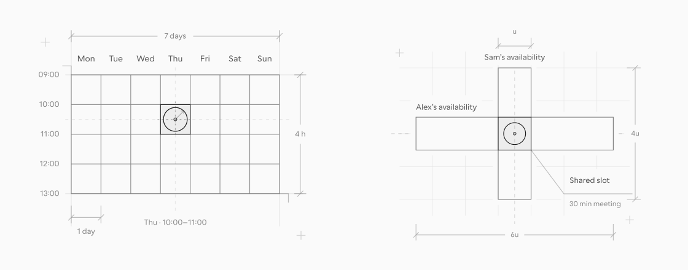

# Plotter

**Blueprint illustrations for product ideas.**

Give your coding agent a brief. Plotter helps it draw precise, editable illustrations for agent workflows, interfaces, empty states, and the concepts behind a feature.

[Explore the catalogue](https://plotter.pasqualevitiello.com/illustrations) · [Install the skill](#install-plotter) · [See it move](#make-it-move) · [Visual grammar](https://plotter.pasqualevitiello.com/grammar) · [Docs](https://plotter.pasqualevitiello.com/docs)

[](https://plotter.pasqualevitiello.com/illustrations)

Use the catalogue as a reference, then ask for a drawing that fits your product. Try the example briefs below with `$plotter` in Codex or `/plotter` in Claude Code.

## Explain interfaces

Expose the alignment behind a reusable control or the spacing that makes a conversation readable. Useful for design-system docs, component libraries, and messaging features.

[](https://plotter.pasqualevitiello.com/illustrations)

[An assembly of parts](skills/plotter/references/catalogue/INT-02.svg) · [A conversation, constructed](skills/plotter/references/catalogue/INT-09.svg)

<details>
<summary>Try an interface illustration</summary>

```text
$plotter Draw an icon, label, and status pill as separate parts
projecting into one interface row. Keep their sizes fixed and
make the shared alignment clear. Deliver an editable SVG
for a component-library page.
```

</details>

## Map connections and agent systems

A selected junction connects one input to one output; a shared key connects two table fragments. Adapt these relationships for tool routing, data models, and system documentation.

[](https://plotter.pasqualevitiello.com/illustrations)

[A connection, located](skills/plotter/references/catalogue/SYS-02.svg) · [Supabase · A shared relation](skills/plotter/references/catalogue/SRV-09.svg)

<details>
<summary>Try an agent-routing illustration</summary>

```text
$plotter Draw three agents A–C opposite three tools 01–03,
arranged as a switching matrix. Select only the junction
connecting agent B to tool 02. Deliver an editable SVG
for a tool-routing guide.
```

</details>

## Give empty states something to say

Let a missing corner break a geometric whole, or an absent link interrupt a route. Use the construction itself to explain a 404 page or an unavailable destination.

[](https://plotter.pasqualevitiello.com/illustrations)

[The missing corner](skills/plotter/references/catalogue/EMP-01.svg) · [An interrupted path](skills/plotter/references/catalogue/EMP-03.svg)

<details>
<summary>Try an empty state</summary>

```text
$plotter Draw a paired-outline route interrupted by one missing link.
Make the gap and unresolved destination the focal point.
Deliver an editable SVG for a 404 page with transparent forms.
```

</details>

## Make schedules visible

Locate a meeting within a measured week, or show where two people’s availability meets. Useful for scheduling features, booking pages, and coordination guides.

[](https://plotter.pasqualevitiello.com/illustrations)

[A week, constructed](skills/plotter/references/catalogue/TIM-03.svg) · [Where schedules meet](skills/plotter/references/catalogue/TIM-05.svg)

<details>
<summary>Try a scheduling illustration</summary>

```text
$plotter Draw Alex’s and Sam’s availability as two measured bands
meeting at one shared slot. Label the people and the meeting,
and make the overlap the focal point. Deliver an editable SVG
for a scheduling feature page.
```

</details>

## Make it move

Use motion to show what changes and what stays fixed. In this iris study, six blades change the opening while the center, outer ring, and aperture readout remain easy to follow.

<a href="https://plotter.pasqualevitiello.com/animations#iris-aperture-animation">
  <picture>
    <source media="(prefers-reduced-motion: reduce)" srcset=".github/assets/iris-aperture.svg">
    
  </picture>
</a>

[Browse the motion studies](https://plotter.pasqualevitiello.com/animations) · [Read the animation workflow](https://plotter.pasqualevitiello.com/docs/animation)

<details>
<summary>Animate an existing drawing</summary>

Attach its editable SVG and describe the movement:

```text
$plotter Animate this iris through three aperture settings.
Keep the center fixed and the hatching attached to its blade.
Update the f-number with the opening, pause at each setting,
and reopen slowly. Deliver standalone HTML with a static fallback.
```

For Claude Code, replace `$plotter` with `/plotter`.

</details>

Get editable SVG for stills, or standalone HTML with a static fallback for motion. Both workflows share the same [visual grammar](https://plotter.pasqualevitiello.com/grammar): transparent forms, a clear line hierarchy, and supporting marks that explain the construction.

## Install Plotter

[Download the complete skill](https://plotter.pasqualevitiello.com/plotter/downloads/plotter.zip), extract it, and place the `plotter` folder in your agent’s skills directory:

| Agent       | Install at                 | Invoke with |
| ----------- | -------------------------- | ----------- |
| Codex       | `~/.codex/skills/plotter`  | `$plotter`  |
| Claude Code | `~/.claude/skills/plotter` | `/plotter`  |

Keep `SKILL.md`, `agents/`, `assets/`, `references/`, and `scripts/` together. Start a new agent session after installation. The skill works independently of the website; from a checkout, you can copy [`skills/plotter`](skills/plotter) directly.

[Installation guide](https://plotter.pasqualevitiello.com/docs/installation) · [Drawing workflow](https://plotter.pasqualevitiello.com/docs/drawing) · [Token customization](https://plotter.pasqualevitiello.com/docs/customization)

<a id="run-the-website"></a>

<details>
<summary>Run the website locally</summary>

With [Bun](https://bun.sh) installed:

```sh
bun install
bun run dev
```

Open [localhost:3000](http://localhost:3000). See [Contributing](CONTRIBUTING.md) for source boundaries, generation, and formatting.

</details>

Made by [Pasquale Vitiello · @pacovitiello](https://x.com/pacovitiello). Built with [coss ui](https://coss.com/ui).

[plotter.pasqualevitiello.com](https://plotter.pasqualevitiello.com) · [MIT license](LICENSE) · [Source credits](ATTRIBUTION.md)
